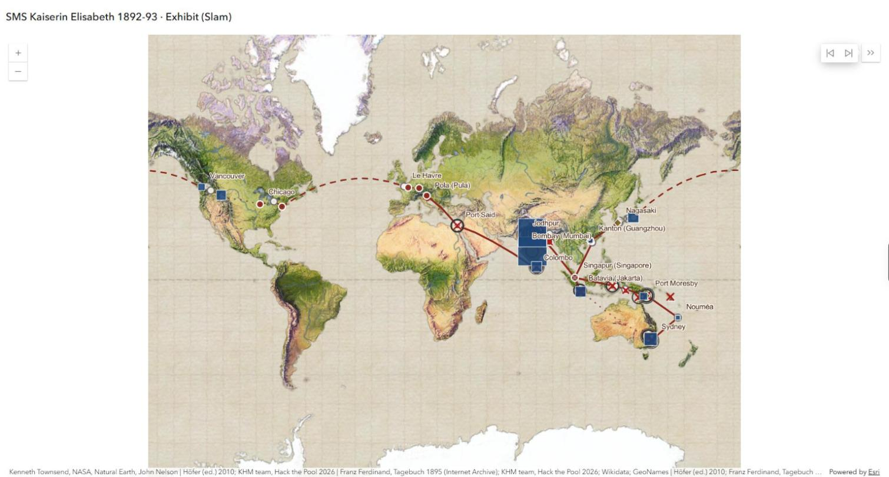

# Karte einbetten: Anleitung für die Webseite

Für alle, die die Karte in eine Webseite einbauen. Alles hier ist öffentlich (seit 28.10.2026);
es braucht kein Login und keinen Schlüssel.

## Die Adressen

| was | Adresse | wofür |
| --- | --- | --- |
| Tour (Exhibit) | `https://cacgeoportal-hub.maps.arcgis.com/apps/instant/exhibit/index.html?appid=c79ee6edf2084f31b3a2f7e0be943596` | geführte Folien durch die Reise; Hauptkarte zum Einbetten |
| Zeitleiste (Slider) | `https://cacgeoportal-hub.maps.arcgis.com/apps/instant/slider/index.html?appid=63327c035045432f95793e26965e0d39` | die Reise Tag für Tag abspielen |
| StoryMap „Who was hunted?“ | `https://storymaps.arcgis.com/stories/c658af3fb35b4688974d3cb214fb500b` | Erzählung in 11 Szenen, ein Tier je Szene, mit eigener Karte „Animal voices“; **verlinken, nicht einbetten** (siehe unten) |
| Web-Karte (Seite) | `https://cacgeoportal-hub.maps.arcgis.com/home/item.html?id=977298da4e1a47c380c77a9041e11908` | Beschreibung, Quellen, Ebenen; zum Verlinken, nicht zum Einbetten |
| Web-Karte (ID) | `977298da4e1a47c380c77a9041e11908` | nur nötig, wenn jemand die Karte selbst mit dem ArcGIS Maps SDK baut |

Geprüft am 28.10.: die App-Seiten senden weder `X-Frame-Options` noch `frame-ancestors`; Einbetten
in fremde Seiten ist also erlaubt. Ein Bildschirmtest der eingebetteten Seite steht noch aus.

## Code zum Einfügen

Responsiv (passt sich der Breite an, Seitenverhältnis 16:10):

```html
<div class="ke-karte">
  <iframe
    src="https://cacgeoportal-hub.maps.arcgis.com/apps/instant/exhibit/index.html?appid=c79ee6edf2084f31b3a2f7e0be943596"
    title="Karte: Die Reise der SMS Kaiserin Elisabeth 1892–93 (ArcGIS Exhibit)"
    loading="lazy" allowfullscreen></iframe>
</div>
<p class="ke-karte-hinweis">
  <a href="https://cacgeoportal-hub.maps.arcgis.com/apps/instant/exhibit/index.html?appid=c79ee6edf2084f31b3a2f7e0be943596"
     target="_blank" rel="noopener">Karte in neuem Fenster öffnen</a> ·
  <a href="https://cacgeoportal-hub.maps.arcgis.com/apps/instant/slider/index.html?appid=63327c035045432f95793e26965e0d39"
     target="_blank" rel="noopener">Zeitleiste</a>
</p>
<style>
  .ke-karte { position: relative; width: 100%; aspect-ratio: 16 / 10; }
  .ke-karte iframe { position: absolute; inset: 0; width: 100%; height: 100%; border: 0; }
  @media (max-width: 600px) { .ke-karte { aspect-ratio: 3 / 4; } }
</style>
```

Für die Zeitleiste denselben Block mit der Slider-Adresse und dem Titel
„Zeitleiste: Die Reise der SMS Kaiserin Elisabeth 1892–93 (ArcGIS Slider)“.

Hinweise:
- Immer den Link „in neuem Fenster öffnen“ dazusetzen: auf dem Handy ist die eingebettete Karte eng,
  und Pop-ups mit Bildern lesen sich im eigenen Fenster besser.
- `title` beim iframe nicht weglassen (Screenreader).
- `loading="lazy"` lädt die Karte erst, wenn man zu ihr scrollt; die Karte ist groß (Bilder, 9 Ebenen).
- Höhe nicht unter etwa 450 px: darunter verdecken die Steuerelemente die Karte.
- Fertiges Beispiel mit beiden Apps: `index.html` in diesem Ordner.

## Die StoryMap „Who was hunted?“

Öffentlich seit 28.10.2026 (veröffentlicht 12:09): https://storymaps.arcgis.com/stories/c658af3fb35b4688974d3cb214fb500b

**Verlinken statt einbetten.** Der StoryMaps-Server sendet für die Story-Adresse
`X-Frame-Options: SAMEORIGIN` (geprüft am 28.10. für alle Adress-Varianten); Browser zeigen sie dann in
einem iframe auf einer fremden Seite in der Regel nicht an. Empfehlung: eine Karte mit Bild und Knopf.

```html
<a class="ke-story" href="https://storymaps.arcgis.com/stories/c658af3fb35b4688974d3cb214fb500b" target="_blank" rel="noopener">
  
  <span class="ke-story-titel">Who was hunted? Eine StoryMap über die Tiere der Reise 1892–93</span>
  <span class="ke-story-knopf">StoryMap öffnen</span>
</a>
<style>
  .ke-story { display: block; max-width: 640px; text-decoration: none; color: inherit;
              border: 1px solid #ccc; border-radius: 6px; overflow: hidden; }
  .ke-story img { width: 100%; display: block; }
  .ke-story-titel { display: block; padding: 12px 16px 4px; font-weight: 600; }
  .ke-story-knopf { display: inline-block; margin: 8px 16px 16px; padding: 6px 12px;
                    background: #7a1f1f; color: #fff; border-radius: 4px; }
</style>
```

(`vorschau_exhibit.jpg` ist ein Platzhalter; besser ein Bild aus der StoryMap selbst, z. B. ein
Screenshot des Titels, mit Bildnachweis.) Wer das Einbetten trotzdem testen will: in der StoryMap
„Teilen → Einbetten“ wählen und den angebotenen Code im Browser auf der echten Seite prüfen; zeigt
der Rahmen nichts an, bleibt es beim Link.

Die Fotos der StoryMap (6 aus dem Weltmuseum Wien) tragen alle CC BY-NC-SA 4.0 über Europeana;
die Bildunterschriften nennen Inventarnummer und Weg (Kulturpool, Europeana).

## Was die Seite neben der Karte nennen sollte

Die Karte selbst nennt Quellen in der Fußzeile, im Details-Panel und in jedem Pop-up. Auf der Seite
reicht ein Satz, zum Beispiel:

> Karte: Hack the Pool 2026, KHM-Team. Quellen: Franz Ferdinand, *Tagebuch meiner Reise um die Erde
> 1892–1893* (Wien 1895); Höfer (Hrsg.), *Imperial Sightseeing* (Wien 2010); Weltmuseum Wien (Fotos
> über Kulturpool und Europeana, Lizenz je Bild); ANNO/ÖNB; Kulturpool; GeoNames; Wikidata. Grundkarte: Esri.

Fotos: 109 tragen CC BY-NC-SA 4.0 (Europeana), die übrigen den Hinweis „Lizenz nicht geprüft“.
Für Screenshots der Karte auf der Webseite nur Fotos mit Lizenzangabe verwenden.

## Eigene Karte statt iframe

Wer die Karte selbst zeichnen will (Leaflet, MapLibre, D3): die Daten liegen als GeoJSON in
`export_2026-10-28/` (WGS84, ein File je Ebene; Feldbeschreibung in `layers.json`, Quellen und Rechte
je Ebene in `items.json`). Der Export ist ein Stand vom 28.10.; die Online-Karte ist die aktuelle
Fassung.

## Wenn die Karte auf GitHub selbst als Seite laufen soll

GitHub zeigt in README-Dateien keine iframes. `index.html` wird erst als Webseite sichtbar, wenn ein
Admin des Repos GitHub Pages einschaltet (Settings → Pages → Branch wählen). Dann lautet die
Adresse `https://richterhenje.github.io/Hack-The-Pool-2026/Kriegsmarine/Analysen/karte/` (nur wenn
Pages für den Branch mit diesem Ordner eingeschaltet wird).
